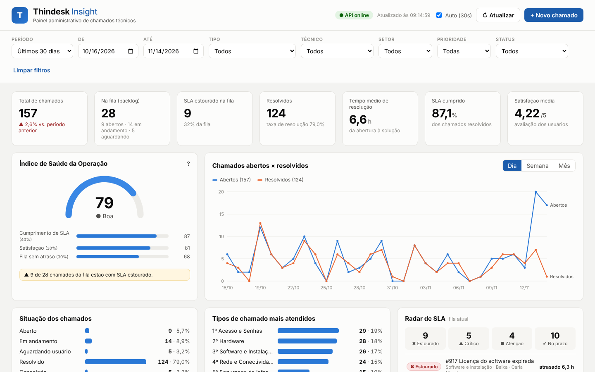

# Thindesk Insight

**Dashboard Administrativo + API REST para o sistema de chamados Thindesk**

Desenvolvido por **Pedro Henrique Campos** — Sistemas de Informação, Universidade de Mogi das Cruzes (UMC).

   



## O que é

Um painel para o responsável pelos chamados acompanhar a operação e **tomar decisões**: indicadores gerais, gráfico de abertos × resolvidos por período, situação dos chamados, ranking dos tipos mais atendidos, filtros, desempenho dos técnicos e o histórico de considerações técnicas de cada chamado.

**A ideia diferente:** além de mostrar números, o painel **aponta o que precisa de atenção**:

- 🩺 **Índice de Saúde da Operação** — uma nota de 0 a 100 (SLA + satisfação + fila sem atraso) com alertas automáticos;
- 🎯 **Radar de SLA** — os chamados da fila que já estouraram ou estão quase estourando o prazo, em ordem de urgência;
- 🔥 **Mapa de calor da demanda** — dia da semana × hora com o horário de pico, para planejar a escala da equipe.

Todos os dados vêm de uma **API REST própria** (15 endpoints) ligada a um **banco SQLite**.

## Como rodar

Requisito: **Python 3.10 ou superior**.

```bash
git clone https://github.com/PedroCamposz/thindesk-dashboard.git
cd thindesk-dashboard
pip install -r requirements.txt
python run.py
```

Abra **http://localhost:5000**. Na primeira execução o banco é criado e preenchido com ~930 chamados de exemplo.

| Comando | O que faz |
|---|---|
| `python run.py` | Sobe API + dashboard na porta 5000 |
| `python run.py --reset` | Recria o banco com os dados de exemplo |
| `python -m pytest` | Roda os 59 testes automatizados |

## Endpoints principais

| Método | Endpoint | Para quê |
|---|---|---|
| GET | `/api/v1/indicadores` | Indicadores gerais (RF01) |
| GET | `/api/v1/chamados/periodo` | Abertos × resolvidos por dia/semana/mês (RF02) |
| GET | `/api/v1/chamados/situacao` | Situação por status (RF03) |
| GET | `/api/v1/tipos/ranking` | Tipos mais atendidos (RF04) |
| GET | `/api/v1/filtros` | Opções dos filtros (RF05) |
| GET | `/api/v1/insights/saude` · `/sla-risco` · `/mapa-calor` | Diferenciais |
| GET/POST | `/api/v1/chamados` | Listar / abrir chamados |
| GET | `/api/v1/chamados/{id}` | Detalhe + considerações técnicas |
| PATCH | `/api/v1/chamados/{id}/status` | Mudar status (RF07) |
| POST | `/api/v1/chamados/{id}/consideracoes` | Registrar consideração técnica (RF07) |

Documentação completa com parâmetros, exemplos e erros: **[docs/API.md](docs/API.md)**.

## Documentação

| Documento | Conteúdo |
|---|---|
| [docs/DOCUMENTACAO.md](docs/DOCUMENTACAO.md) | Requisitos funcionais e não funcionais, regras de negócio, arquitetura, modelagem (DER), decisões de projeto e Gitflow |
| [docs/API.md](docs/API.md) | Documentação de todos os endpoints |
| [docs/TESTES.md](docs/TESTES.md) | Evidências de testes (automatizados, interface e robustez) com prints |
| [docs/ROTEIRO_VIDEO.md](docs/ROTEIRO_VIDEO.md) | Roteiro da apresentação em vídeo |

## Estrutura

```
thindesk-dashboard/
├── app/
│   ├── __init__.py        # cria a aplicação Flask
│   ├── api.py             # rotas /api/v1/...
│   ├── servicos.py        # consultas SQL e cálculos
│   ├── filtros.py         # validação dos filtros
│   ├── regras.py          # regras de negócio (SLA, status, saúde)
│   ├── erros.py           # formato padrão de erro
│   ├── db.py · schema.sql · seed.py   # banco SQLite e dados de exemplo
│   └── static/            # dashboard (index.html, css/, js/)
├── tests/                 # 59 testes pytest
├── docs/                  # documentação e evidências
├── run.py
└── requirements.txt
```

## Gitflow

`main` (estável, tag `v1.0.0`) · `develop` · `feature/modelagem-banco` · `feature/api-endpoints` · `feature/dashboard` · `feature/testes-documentacao` · `release/1.0.0`

---

© 2026 Pedro Henrique Campos
