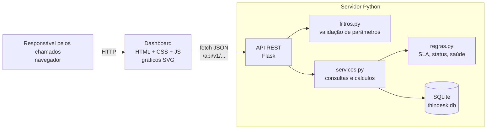
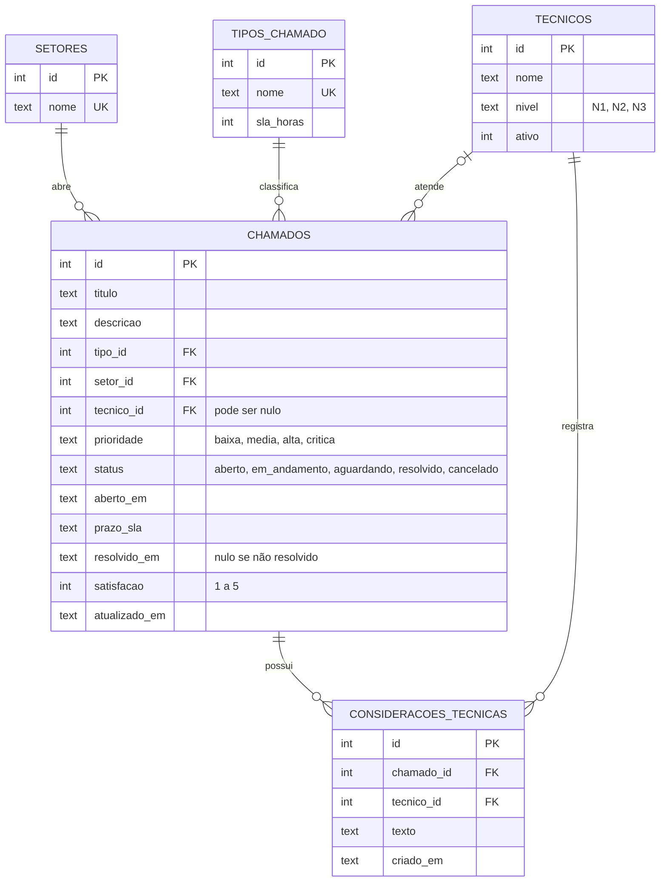

# Thindesk Insight — Documento do Projeto

| | |
|---|---|
| **Aluno** | Pedro Henrique Campos |
| **Curso** | Sistemas de Informação — Universidade de Mogi das Cruzes (UMC) |
| **Atividade** | Dashboard Administrativo integrado ao sistema de chamados Thindesk |
| **Versão** | 1.0.0 — novembro/2026 |
| **Repositório** | https://github.com/PedroCamposz/thindesk-dashboard |

---

## 1. Contextualização

O **Thindesk** é um sistema de chamados técnicos (help desk). O responsável pelo atendimento precisa saber, rapidamente, *como está a operação*: quantos chamados existem, quantos estão parados, quais tipos dão mais trabalho, se os prazos estão sendo cumpridos e o que os técnicos registraram em cada caso.

Este projeto entrega:

1. uma **API REST** (Python + Flask) que lê e grava em um **banco SQLite** e calcula indicadores, séries temporais, rankings e regras de SLA;
2. um **Dashboard Administrativo** web que consome essa API e apresenta tudo de forma visual, com filtros e atualização automática.

### 1.1 A ideia diferente: de “painel que mostra números” para “painel que avisa o que fazer”

Além dos requisitos mínimos, o painel foi pensado para **ajudar na tomada de decisão**, com três recursos que normalmente não aparecem em dashboards de chamados:

| Recurso | O que faz | Decisão que apoia |
|---|---|---|
| **Índice de Saúde da Operação** (0–100) | Junta em um número só o cumprimento de SLA (40%), a satisfação dos usuários (30%) e a fila sem atraso (30%), com classificação (Excelente / Boa / Atenção / Crítica) e alertas em texto | “A operação está bem hoje? O que está puxando a nota pra baixo?” |
| **Radar de SLA** | Olha a fila atual e mostra quais chamados já estouraram o prazo ou estão quase estourando (≥ 75% ou ≥ 50% do prazo consumido), com contagem regressiva | “Qual chamado eu preciso priorizar agora?” |
| **Mapa de calor da demanda** | Cruza dia da semana × hora em que os chamados são abertos e indica o horário de pico | “Em que dia e horário devo reforçar a equipe?” |

Também foram incluídos: comparação automática com o período anterior, desempenho por técnico, histórico de **considerações técnicas** com registro pelo próprio painel, atualização de status com **máquina de estados**, abertura de chamados com **SLA calculado automaticamente** e exportação para CSV.

---

## 2. Requisitos funcionais

| ID | Requisito | Como foi atendido | Endpoint(s) | Tela |
|---|---|---|---|---|
| **RF01** | Indicadores gerais de chamados técnicos | 7 cartões: total (com variação vs. período anterior), backlog, SLA estourado na fila, resolvidos, tempo médio de resolução, % SLA cumprido e satisfação média. Tabela de desempenho por técnico | `GET /indicadores`, `GET /tecnicos/desempenho` | Cartões do topo e “Desempenho da equipe técnica” |
| **RF02** | Análise de chamados atendidos por período (gráficos) | Gráfico de linhas *abertos × resolvidos* com agrupamento por dia, semana ou mês, tooltip com SLA e tempo médio de cada período | `GET /chamados/periodo` | “Chamados abertos × resolvidos” |
| **RF03** | Situação dos chamados | Barras com quantidade e % de cada status + fila por prioridade; detalhe de cada chamado com considerações técnicas | `GET /chamados/situacao`, `GET /chamados/{id}` | “Situação dos chamados” e janela de detalhe |
| **RF04** | Tipos de chamados mais atendidos | Ranking com posição, total, participação %, tempo médio e % SLA por tipo | `GET /tipos/ranking` | “Tipos de chamado mais atendidos” |
| **RF05** | Filtros de consulta | Período (atalhos 7/30/90/180 dias ou datas livres), tipo, técnico, setor, prioridade e status — aplicados a **todos** os blocos de uma vez; busca por título/nº na lista; clique no técnico filtra o painel | Todos os endpoints de consulta + `GET /filtros` | Barra de filtros |
| **RF06** | Integração com a API | O dashboard não tem dados “fixos”: tudo vem da API via `fetch` (módulo `api.js`), com timeout de 10 s, nova tentativa automática em falha de rede e mensagens de erro da própria API | Todos | Todo o painel |
| **RF07** | Atualização e tratamento de dados | **Atualização:** auto-refresh a cada 30 s (pausa com janela aberta ou aba oculta), botão “Atualizar”, criação de chamados, mudança de status e registro de considerações direto pelo painel. **Tratamento:** validação de todos os parâmetros, normalização de texto, campos nulos tratados (ex.: “—”), períodos sem dados preenchidos com zero, regras de transição de status, erros padronizados em JSON e aviso visual de “API offline” com botão “Tentar novamente” | `POST /chamados`, `PATCH /chamados/{id}/status`, `POST /chamados/{id}/consideracoes` | Botões “+ Novo chamado”, “Atualizar”, janela do chamado |

### Requisitos funcionais adicionais (diferenciais)

| ID | Requisito | Endpoint |
|---|---|---|
| RF08 | Índice de Saúde da Operação com alertas | `GET /insights/saude` |
| RF09 | Radar de SLA da fila atual | `GET /insights/sla-risco` |
| RF10 | Mapa de calor de demanda (dia × hora) | `GET /insights/mapa-calor` |
| RF11 | Exportação da lista filtrada para CSV (abre no Excel) | `GET /chamados` (paginado) |

---

## 3. Requisitos não funcionais

| ID | Categoria | Requisito | Como foi atendido |
|---|---|---|---|
| RNF01 | Desempenho | As consultas do painel devem responder em menos de 1 s com ~1.000 chamados | Agregações feitas no SQL (COUNT/AVG/SUM) e índices em `aberto_em`, `resolvido_em`, `status`, `tipo_id`, `tecnico_id`. Os 59 testes completos rodam em ~1,5 s |
| RNF02 | Segurança | Impedir SQL injection e entradas maliciosas | 100% das consultas parametrizadas (`?`), lista branca para ordenação/status/prioridade, escape de HTML no front (sem XSS), limites de tamanho nos textos |
| RNF03 | Confiabilidade | Erros nunca devem “quebrar” o painel nem devolver HTML | Handler global devolve sempre JSON `{erro:{codigo,mensagem,detalhes}}`; front usa `Promise.allSettled` (um bloco com erro não derruba os outros) |
| RNF04 | Usabilidade | Interface em português, clara, sem precisar de treinamento | Rótulos em PT-BR, tooltips, estados de carregamento, mensagens de erro amigáveis, datas no formato dd/mm/aaaa |
| RNF05 | Acessibilidade | Informação não pode depender só de cor | Status de SLA sempre com **ícone + texto** (✖ Estourado, ▲ Crítico, ● Atenção, ✔ No prazo), legendas e rótulos diretos nos gráficos, paleta testada para daltonismo, `aria-label` nos gráficos |
| RNF06 | Portabilidade | Rodar em Windows, Linux ou macOS com o mínimo de instalação | Só Python 3.10+ e Flask; banco SQLite em arquivo (criado sozinho); front sem bibliotecas externas/CDN (gráficos em SVG puro) — funciona até offline |
| RNF07 | Manutenibilidade | Código organizado e documentado | Camadas separadas (rotas → serviços → banco), regras de negócio isoladas em `regras.py`, docstrings, padrão REST |
| RNF08 | Testabilidade | Funcionalidades cobertas por testes automatizados | 59 testes `pytest` com banco temporário isolado e “data atual” fixa; CI no GitHub Actions roda os testes a cada push |
| RNF09 | Interoperabilidade | A API deve poder ser usada por outros sistemas | JSON UTF-8, códigos HTTP corretos (200/201/400/404/405/409/422/500), cabeçalho `Location`, CORS liberado |
| RNF10 | Versionamento | Código versionado com Gitflow | Branches `main`, `develop`, `feature/*`, `release/1.0.0` e tag `v1.0.0` |

---

## 4. Regras de negócio

| ID | Regra |
|---|---|
| RN01 | **Prazo de SLA** = data de abertura + (SLA base do tipo × fator da prioridade). Fatores: crítica 0,25 · alta 0,5 · média 1,0 · baixa 1,5. Ex.: Hardware (24 h) com prioridade alta → 12 h |
| RN02 | Um chamado resolvido está **dentro do SLA** se `resolvido_em ≤ prazo_sla` |
| RN03 | **Backlog** (fila) = chamados com status aberto, em andamento ou aguardando |
| RN04 | **Atrasado** = chamado da fila cujo prazo já venceu |
| RN05 | Transições de status permitidas: aberto→{em andamento, cancelado}; em andamento→{aguardando, resolvido, cancelado}; aguardando→{em andamento, cancelado}; resolvido→{em andamento} (reabertura); cancelado é final |
| RN06 | Ao resolver, grava-se `resolvido_em`; a nota de satisfação (1–5) só pode ser enviada ao resolver; reabrir apaga as duas |
| RN07 | Radar de SLA: estourado (< 0 h restantes), crítico (≥ 75% do prazo consumido), atenção (≥ 50%), no prazo (< 50%) |
| RN08 | Índice de Saúde = 0,4·SLA% + 0,3·((satisfação−1)/4·100) + 0,3·(% da fila sem atraso). Sem dados, cada componente vale 100 |
| RN09 | Filtros de data usam a **data de abertura** do chamado; a série de “resolvidos” usa a **data de resolução** |

---

## 5. Arquitetura



| Camada | Arquivo | Responsabilidade |
|---|---|---|
| Rotas | `app/api.py` | Define os endpoints, lê parâmetros e monta a resposta padrão |
| Validação | `app/filtros.py` | Converte e valida a query string (datas, listas, ids) |
| Serviços | `app/servicos.py` | Consultas SQL, agregações e cálculos dos indicadores |
| Regras | `app/regras.py` | Constantes e regras de negócio puras (fácil de testar) |
| Erros | `app/erros.py` | Formato único de erro em JSON |
| Banco | `app/db.py`, `app/schema.sql`, `app/seed.py` | Conexão, modelo de dados e massa de dados de exemplo |
| Front | `app/static/` | `api.js` (cliente HTTP), `graficos.js` (gráficos SVG), `app.js` (telas e eventos) |

---

## 6. Modelagem de dados



**Decisões de modelagem**

- `prazo_sla` é **gravado** na abertura (e não calculado a cada consulta): se o SLA de um tipo mudar no futuro, os chamados antigos continuam sendo avaliados pelo prazo que valia quando foram abertos.
- `tecnico_id` é opcional porque um chamado pode estar na fila sem ninguém atribuído.
- `CHECK` constraints no banco garantem status, prioridade, nível e nota válidos mesmo que alguém grave direto no SQLite.
- Considerações técnicas ficam em tabela própria (1:N) para manter o **histórico** com autor e data, em vez de um campo de texto que seria sobrescrito.
- Índices nas colunas usadas em filtros e agrupamentos.

**Massa de dados:** `seed.py` gera ~930 chamados realistas dos últimos 6 meses (mais chamados em dias úteis e horário comercial, tipos e prioridades com pesos diferentes, técnicos com velocidades diferentes, satisfação menor quando o SLA estoura) e a fila atual. É **determinístico** (mesma semente = mesmos dados), o que facilita testes e a apresentação.

---

## 7. Principais decisões de projeto

| Decisão | Alternativas consideradas | Justificativa |
|---|---|---|
| **Flask** (Python) | FastAPI, Node/Express | Leve, simples de explicar e de rodar; ótimo suporte a testes com `test_client` |
| **SQLite** | MySQL, PostgreSQL | Zero configuração: o banco é um arquivo criado automaticamente. As consultas usam SQL padrão, então a troca para outro SGBD é simples |
| **Endpoints por recurso/indicador** (`/indicadores`, `/chamados/periodo`, `/tipos/ranking`…) | Um único endpoint “gigante” com tudo | Cada bloco do painel carrega em paralelo e independente; se um falhar, os outros continuam; a API fica reutilizável por outros sistemas |
| **Cálculos no back-end** | Mandar todos os chamados e calcular no navegador | Menos dados trafegando, regra de negócio em um só lugar, resultados consistentes para qualquer cliente |
| **Gráficos em SVG puro** | Chart.js, ECharts | Nenhuma dependência externa/CDN (funciona offline na apresentação) e controle total do visual e da acessibilidade |
| **Formato padrão de resposta** (`dados` + `meta`) e de erro (`erro.codigo`) | Respostas livres | O front trata tudo de forma uniforme e o usuário sempre recebe uma mensagem clara |
| **422 vs 400 vs 409** | Tudo como 400 | Diferencia parâmetro de URL errado (400), corpo inválido (422) e regra de negócio violada (409) — facilita o diagnóstico |
| **“Agora” configurável** (`NOW`) | Usar sempre o relógio | Permite testes determinísticos de SLA/prazos |

---

## 8. Gitflow

Fluxo seguido:

```
main  ──●──────────────────────────────────────────────────────────●── tag v1.0.0
         └─ develop ──●──────●──────●──────●──────●─ release/1.0.0 ─┘
                      │      │      │      │
   feature/modelagem-banco   │      │      └─ feature/testes-documentacao
          feature/api-endpoints     └─ feature/dashboard
```

1. `develop` é criada a partir de `main`.
2. Cada funcionalidade nasce em uma `feature/*` a partir de `develop` e volta por *merge* (`--no-ff`, preservando o histórico da branch).
3. Com tudo integrado, `release/1.0.0` é criada, recebe o ajuste de versão e é mesclada em `main` (com a tag `v1.0.0`) e de volta em `develop`.

| Branch | Uso |
|---|---|
| `main` | Versão estável entregue (tag `v1.0.0`) |
| `develop` | Integração das funcionalidades |
| `feature/modelagem-banco` | Modelo de dados e massa de exemplo |
| `feature/api-endpoints` | **Implementação da API com os endpoints integrados ao banco** |
| `feature/dashboard` | Dashboard administrativo |
| `feature/testes-documentacao` | Testes automatizados, evidências e documentação |
| `release/1.0.0` | Preparação da entrega |

---

## 9. Como executar

```bash
git clone https://github.com/PedroCamposz/thindesk-dashboard.git
cd thindesk-dashboard
pip install -r requirements.txt
python run.py            # cria o banco na 1ª vez e sobe em http://localhost:5000
python run.py --reset    # recria os dados de exemplo
python -m pytest         # roda os testes
```

---

## 10. Documentos relacionados

- [Documentação dos endpoints](API.md) — parâmetros, exemplos de requisição/resposta e erros
- [Evidências de testes](TESTES.md) — testes automatizados, testes manuais e prints
- [Roteiro do vídeo de apresentação](ROTEIRO_VIDEO.md)
