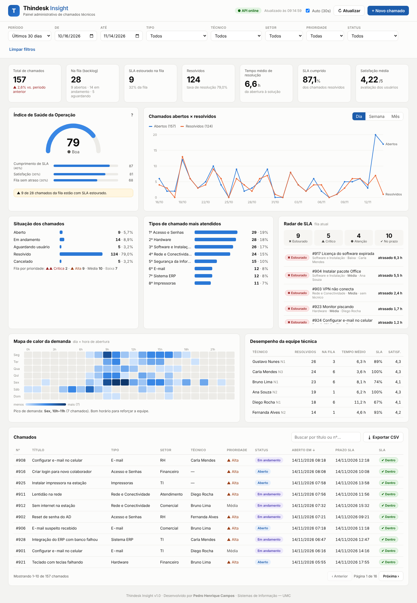
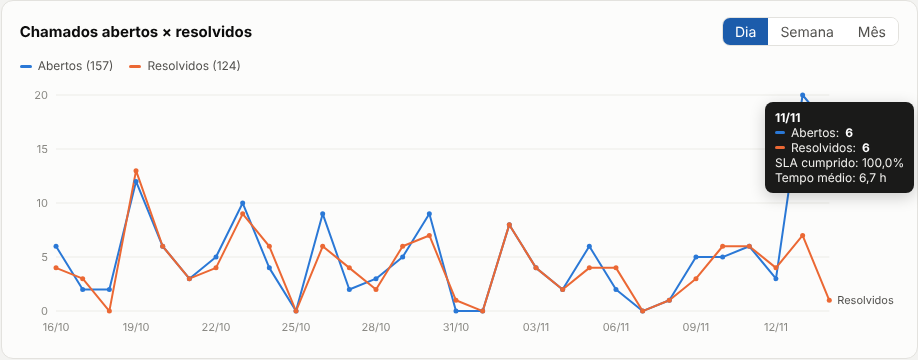
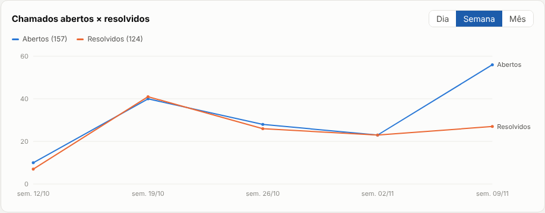
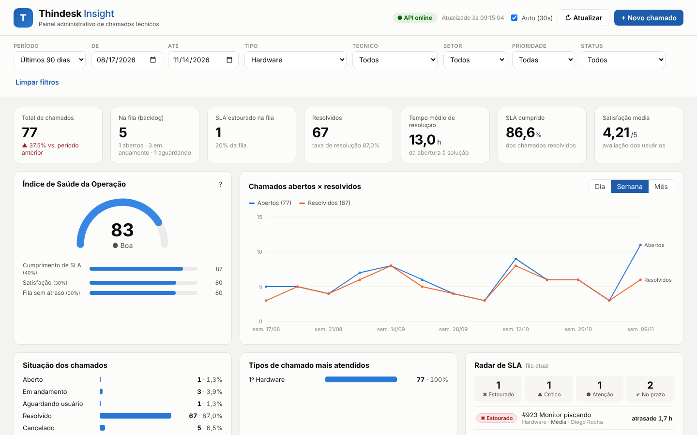
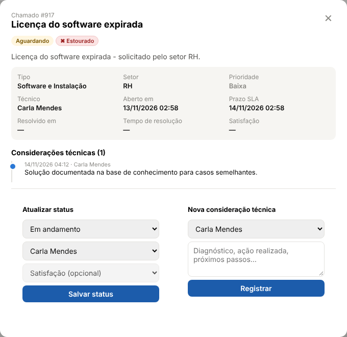
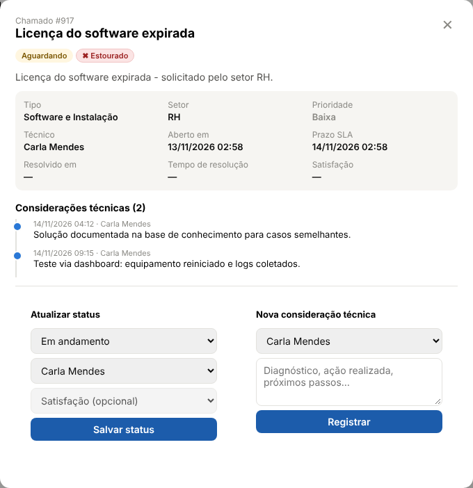
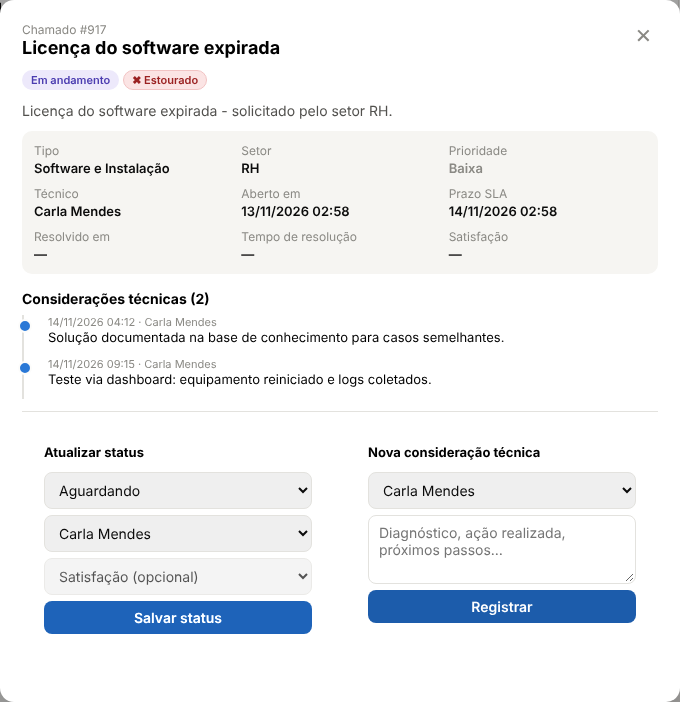
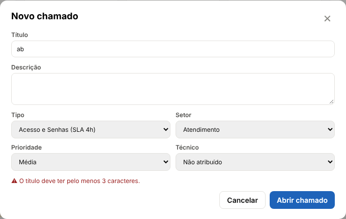
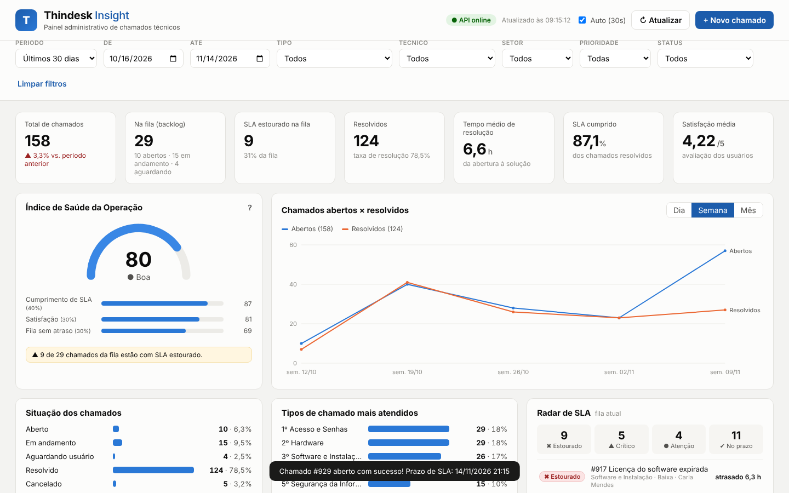
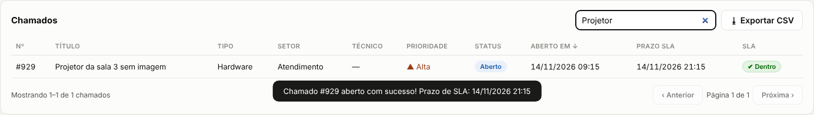

# Evidências de Testes — Thindesk Insight

**Autor:** Pedro Henrique Campos · **Data da execução:** 14/11/2026

## 1. Estratégia

| Tipo | Ferramenta | O que cobre |
|---|---|---|
| **Testes automatizados de API (integração)** | `pytest` + `Flask test_client` | Todos os 15 endpoints, filtros, cálculos, validações, códigos HTTP e formato de erro |
| **Testes unitários de regras de negócio** | `pytest` | Cálculo de prazo de SLA, transições de status, classificação do Índice de Saúde |
| **Testes de interface (E2E)** | Playwright + Google Chrome (headless) | Carregamento do dashboard sem erros de console, filtros, gráficos, detalhe, criação e atualização de chamados |
| **Integração contínua** | GitHub Actions (`.github/workflows/testes.yml`) | Roda a suíte completa a cada *push* e *pull request* |

Para os cálculos serem conferidos com **valores exatos**, os testes usam dois bancos temporários e isolados (criados e apagados a cada teste):

- **massa mínima** (`client_mini`): 5 chamados escritos à mão, com resultados calculáveis no papel (ex.: tempo médio = (4 h + 10 h) / 2 = 7 h; Índice de Saúde = 0,4·50 + 0,3·75 + 0,3·50 = 57,5);
- **massa completa** (`client`): os ~930 chamados do *seed*, para validar consistência e paginação.

A “data atual” é fixada em **14/11/2026 12:00** (`NOW`), então prazos e SLA dão sempre o mesmo resultado, em qualquer dia em que os testes forem rodados.

## 2. Como executar

```bash
pip install -r requirements.txt
python -m pytest            # saída detalhada (configurada em pytest.ini)
```

## 3. Resultado

```
platform linux -- Python 3.13.18, pytest-9.1.1
collected 59 items

tests/test_chamados.py ..............                                    [ 23%]
tests/test_filtros_e_erros.py ...........................                [ 69%]
tests/test_indicadores.py ...........                                    [ 88%]
tests/test_insights.py .......                                           [100%]

============================== 59 passed in 1.46s ==============================
```

Log completo: [`evidencias/resultado-testes.txt`](evidencias/resultado-testes.txt)

## 4. Casos de teste automatizados

| # | Requisito | Caso de teste | Entrada | Resultado esperado | Status |
|---|---|---|---|---|---|
| CT01 | RF01 | `test_indicadores_valores_exatos` | `GET /indicadores` (massa mínima) | total 5, backlog 2, atrasados 1, tempo médio 7,0 h, SLA 50%, satisfação 4,0 | ✅ |
| CT02 | RF01 | `test_indicadores_comparacao_periodo_anterior` | período 10–14/11 | período anterior = 0 → variação `null` | ✅ |
| CT03 | RF01 | `test_indicadores_massa_completa_consistente` | massa completa | soma dos status = total; SLA entre 0 e 100 | ✅ |
| CT04 | RF06 | `test_meta_informa_filtros_aplicados` | `?status=resolvido&tipo_id=1` | `meta.filtros_aplicados` ecoa os filtros | ✅ |
| CT05 | RF02 | `test_periodo_por_dia_preenche_dias_sem_chamados` | 10 a 14/11 por dia | 5 pontos; dias sem chamados com 0 | ✅ |
| CT06 | RF02 | `test_periodo_por_semana_e_mes` | semana / mês | chave da semana = segunda-feira; meses `AAAA-MM` | ✅ |
| CT07 | RF02 | `test_periodo_padrao_ultimos_30_dias` | sem datas | 30 pontos, de 16/10 a 14/11 | ✅ |
| CT08 | RF03 | `test_situacao_lista_todos_os_status` | `GET /chamados/situacao` | 5 status (inclusive com 0), %, fila por prioridade | ✅ |
| CT09 | RF04 | `test_ranking_tipos` | massa mínima | 1º lugar “Rede”, 100% | ✅ |
| CT10 | RF04 | `test_ranking_tipos_ordenado_e_limitado` | `?limite=3` | 3 itens em ordem decrescente | ✅ |
| CT11 | RF01 | `test_desempenho_tecnicos` | `GET /tecnicos/desempenho` | Ana: 2 atribuídos, 1 resolvido, SLA 100% | ✅ |
| CT12–21 | RF05 | `test_filtros_reduzem_resultado` (10 cenários) | status, lista de status, técnico, setor, prioridade, datas, tipo | contagens exatas por filtro | ✅ |
| CT22 | RF05 | `test_filtros_combinados` | status + técnico | 1 chamado (“Sem internet”) | ✅ |
| CT23 | RF05 | `test_endpoint_de_opcoes_de_filtro` | `GET /filtros` | 8 tipos, 6 técnicos, 7 setores | ✅ |
| CT24–30 | RF07 | `test_filtros_invalidos_retornam_400` (7 cenários) | data em formato BR, data início > fim, status/prioridade inexistentes, id não numérico, id inexistente, id 0 | `400 PARAMETRO_INVALIDO` com mensagem clara | ✅ |
| CT31 | RF07 | `test_agrupamento_invalido` | `?agrupamento=ano` | 400 | ✅ |
| CT32 | RF07 | `test_limite_fora_da_faixa` | `limite=0` e `51` | 400 | ✅ |
| CT33 | RF07 | `test_paginacao_e_ordenacao_invalidas` | página 0, 500 por página, ordenar por campo proibido | 400 | ✅ |
| CT34 | RNF02 | `test_tentativa_de_sql_injection_e_tratada` | `busca=' OR 1=1 --` | tratado como texto: 0 resultados; nada vaza | ✅ |
| CT35 | RNF03 | `test_rota_inexistente_404_json` | `/api/v1/nao-existe` | 404 em JSON | ✅ |
| CT36 | RNF03 | `test_metodo_nao_permitido_405_json` | `DELETE /indicadores` | 405 em JSON | ✅ |
| CT37 | RNF09 | `test_health_e_cors` | `/health` | banco conectado + cabeçalho CORS | ✅ |
| CT38 | RF06 | `test_dashboard_e_arquivos_estaticos` | `/` e `/static/*` | página com nome do autor; JS/CSS 200 | ✅ |
| CT39 | RF03 | `test_listagem_paginada` | `por_pagina=7&pagina=2` | 7 itens; total de páginas correto | ✅ |
| CT40 | RF05 | `test_listagem_ordenada_por_data` | `ordenar=aberto_em&direcao=asc` | datas em ordem crescente | ✅ |
| CT41 | RF05 | `test_busca_por_titulo_e_numero` | `busca=vpn` / `busca=4` | encontra por texto e por nº | ✅ |
| CT42 | RF03 | `test_detalhe_com_consideracoes_tecnicas` | `GET /chamados/1` | 4,0 h de resolução, dentro do SLA, consideração listada | ✅ |
| CT43 | RF07 | `test_detalhe_inexistente_404` | `GET /chamados/9999` | 404 `NAO_ENCONTRADO` | ✅ |
| CT44 | RF07 | `test_criar_chamado_calcula_sla_pela_prioridade` | POST prioridade crítica, tipo 8 h | 201, `Location`, prazo = +2 h, espaços normalizados, entra nos indicadores | ✅ |
| CT45 | RF07 | `test_criar_chamado_validacao_422` | título curto, tipo inexistente, sem setor, prioridade inválida, técnico como texto | 422 listando os 5 campos | ✅ |
| CT46 | RF07 | `test_criar_chamado_json_invalido_400` | corpo não-JSON / lista | 400 `JSON_INVALIDO` | ✅ |
| CT47 | RF07 | `test_fluxo_completo_de_status` | aberto → em andamento → resolvido (nota 4) → reaberto | datas e nota gravadas e depois limpas | ✅ |
| CT48 | RF07 | `test_transicao_invalida_409` | aberto → resolvido; cancelado → aberto | 409 com transições permitidas | ✅ |
| CT49 | RF07 | `test_status_inexistente_e_satisfacao_invalida_422` | status “fechado”, nota 9, nota sem resolver | 422 | ✅ |
| CT50 | RF07 | `test_status_chamado_inexistente_404` | PATCH chamado 777 | 404 | ✅ |
| CT51 | RF07 | `test_adicionar_consideracao` | POST consideração | 201 e aparece no detalhe | ✅ |
| CT52 | RF07 | `test_consideracao_invalida` | texto curto, sem técnico, chamado inexistente | 422 / 404 | ✅ |
| CT53 | RF08 | `test_indice_de_saude_calculo` | massa mínima | componentes 50/75/50 → índice 57,5 “Atenção”, 2 alertas | ✅ |
| CT54 | RF08 | `test_indice_de_saude_sem_dados` | filtro sem chamados | índice 100, sem alertas (sem divisão por zero) | ✅ |
| CT55 | RF09 | `test_radar_de_sla` | massa mínima | #3 estourado (−2 h), #4 atenção (50%) | ✅ |
| CT56 | RF09 | `test_radar_ignora_status_finalizados` | `status=resolvido` | lista vazia | ✅ |
| CT57 | RF10 | `test_mapa_de_calor` | massa mínima | matriz 7×24, terça 9h/10h e sábado 2h marcados | ✅ |
| CT58 | RN | `test_regras_de_negocio_unitarias` | funções puras | prazos, transições e classificação corretos | ✅ |
| CT59 | RNF08 | `test_seed_e_deterministico` | gerar a massa 2 vezes | resultados idênticos | ✅ |

## 5. Testes de interface (E2E) com evidências

Executados com Playwright no Google Chrome (1440×900). **Nenhum erro de JavaScript no console** durante todo o roteiro.

| # | Cenário | Passos | Resultado | Evidência |
|---|---|---|---|---|
| E01 | Painel completo carrega da API | Abrir `http://localhost:5000` | Todos os blocos preenchidos, “API online” |  |
| E02 | Tooltip do gráfico | Passar o mouse no gráfico | Mostra abertos, resolvidos, SLA e tempo médio do dia |  |
| E03 | Agrupamento por semana | Clicar em “Semana” | Gráfico reagrupado |  |
| E04 | Filtros combinados | 90 dias + tipo Hardware | Todos os blocos refletem o filtro; ranking só com Hardware |  |
| E05 | Detalhe + considerações técnicas | Clicar em um chamado do Radar de SLA | Janela com dados, histórico e ações |  |
| E06 | Registrar consideração | Escrever texto e “Registrar” | Consideração aparece no histórico |  |
| E07 | Atualizar status | “Salvar status” | Status muda para “Em andamento” e as opções mudam conforme a regra |  |
| E08 | Validação no formulário | Título com 2 letras | Mensagem de erro, nada é enviado |  |
| E09 | Novo chamado | Preencher e enviar (Hardware, alta) | Toast com prazo de SLA calculado (+12 h) e painel atualizado |  |
| E10 | Busca | Digitar “Projetor” | Lista mostra o chamado criado |  |

## 6. Testes complementares de robustez

Também executados no navegador (automatizados com Playwright para registrar o resultado):

| # | Cenário | Resultado obtido |
|---|---|---|
| M01 | Derrubar o servidor com o painel aberto e clicar em “Atualizar” | Aviso “Não foi possível carregar 8 de 8 blocos. Não foi possível conectar à API.”, selo muda para “API offline”, botão “Tentar novamente” — [print](evidencias/12-api-offline.png) |
| M02 | Subir o servidor de novo e clicar em “Tentar novamente” | Painel volta ao normal, selo “API online” |
| M03 | Data inicial maior que a final no filtro | Aviso na tela; nenhuma requisição inválida enviada |
| M04 | Auto-atualização ligada por 30 s | Horário de “Atualizado às” muda sozinho; pausa com uma janela aberta |
| M05 | Exportar CSV | Baixou `chamados_thindesk_2026-11-14.csv` com 158 linhas (todas as páginas do filtro), separador `;` e UTF-8 com BOM (acentos corretos no Excel) |
| M06 | Requisições via `curl` em todos os endpoints | Respostas conforme [API.md](API.md) |
